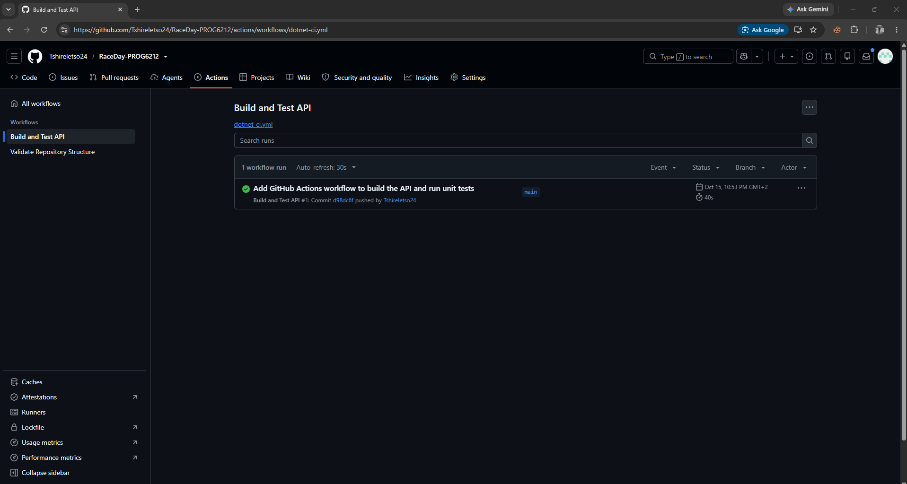

# RaceDay – PROG6212 Portfolio of Evidence

## System Description

RaceDay is a full-stack, web-based event management system built for the South African road running, walking, and cycling community. The platform allows Event Organisers to create and manage events, categories, and participant results, while Participants can browse upcoming events, enter events, and track their personal performance history.

This repository contains the Portfolio of Evidence (POE), submitted progressively across three parts:

- **Part 1** – System planning: Entity Relationship Diagram, API endpoint plan, and SQL database script.
- **Part 2** – RESTful API built in C# (ASP.NET Core), connected to the database, with unit tests and CI/CD.
- **Part 3** – MVC web application consuming the API, with Azure Blob Storage integration and Docker containerisation.

## User Roles

The system supports two distinct user roles:

- **Organiser** – Can create, edit, and delete events, manage event categories, capture participant results, and view all event enrolments.
- **Participant** – Can create an account, browse events, enter an event by selecting a category, view their own enrolments, and track their personal results.

## Part 1 – System Planning and Database

All Part 1 planning documents are located in the [`/docs`](./docs) folder:

- `RaceDay_ERD.png` – Entity Relationship Diagram
- `RaceDay EndPoint.docx` – API Endpoint Plan
- `RaceDayDB.sql` – SQL database creation and seed script

### Running the SQL Script

1. Open SQL Server Management Studio (SSMS).
2. Open `docs/RaceDayDB.sql`.
3. Execute the `CREATE DATABASE RaceDayDB;` statement on its own.
4. Execute the remainder of the script to create all tables and seed sample data.

## CI/CD

A GitHub Actions workflow validates the repository structure, confirming the `/docs` folder exists and contains the required files.

**Latest successful build:**


## Video Demonstration

**Part 1 walkthrough (unlisted YouTube video):** https://youtube.com/shorts/AEKODOYWIJU?si=fPHDPaaOuJMtye71

The video covers:
- The ERD and the reasoning behind each entity and relationship
- The API endpoint plan and key design decisions (role enforcement, resource nesting)
- A live run of the SQL script in SSMS, from a clean database through to seeded sample data

## AI Usage Disclosure

This project used AI assistance (Claude) for planning guidance on database design decisions, structuring the API endpoint plan, and debugging SQL Server errors encountered while writing and testing the database script. All code was typed and tested independently by the student in SSMS.
cd Part2-API
dotnet test
```

There are 64 tests covering registration and login, event management by Organisers, role-based rejection (401 and 403), enrolments being recorded correctly, and results. Tests run against an in-memory database, so they never touch the real one.

### CI/CD

The workflow `.github/workflows/dotnet-ci.yml` builds the solution and runs all unit tests on every push.

**Latest successful build:**

   ) 

### Deviations from the Part 1 plan

| Change | Reason |
|---|---|
| `Status` column added to `Enrolments` (Pending, Confirmed, Cancelled) | Needed for the colour-coded enrolment statuses in Part 3 |
| New endpoint `PUT /api/enrolments/{id}/status` | Lets Organisers confirm or cancel enrolments |
| `organiserCode` added to the register request | Prevents users from self-registering as Organisers |
| `GET /api/events` accepts optional `eventTypeId`, `includePast` and `mine` query parameters | Filtering and the Organiser dashboard |
| Extra status codes (e.g. 409 on duplicate results or categories with enrolments) | Safer handling of conflicts |
| Part 2 database is named `RaceDayApiDB` (created by the EF Core migration) | Keeps the Part 1 `RaceDayDB` script intact |

### Video demonstration (Part 2)

**Unlisted YouTube video:** <!-- INSERT PART 2 YOUTUBE LINK HERE -->

### AI usage disclosure (Part 2)
This project includes assistance from Claude Ai this model  helped reach full productivity in debugging and problem solving.
<!-- Update this to describe how AI was used in Part 2 (e.g. planning the API structure, drafting code and tests that you reviewed, tested and understood, and debugging build errors). -->