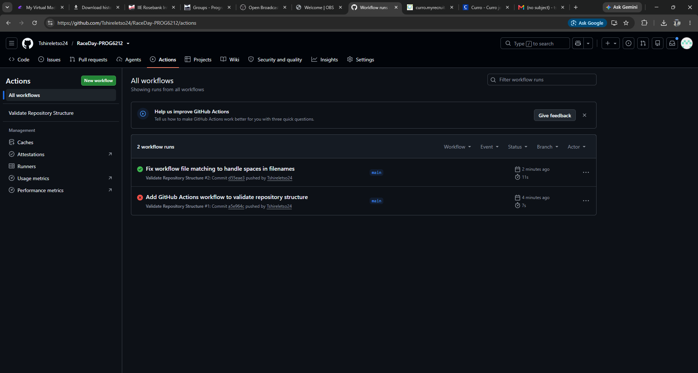

# RaceDay – PROG6212 Portfolio of Evidence

## System Description

RaceDay is a full-stack, web-based event management system built for the South African road running, walking, and cycling community. The platform allows Event Organisers to create and manage events, categories, and participant results, while Participants can browse upcoming events, enter events, and track their personal performance history.

This repository contains the Portfolio of Evidence (POE), submitted progressively across three parts:

- **Part 1** – System planning: Entity Relationship Diagram, API endpoint plan, and SQL database script.
- **Part 2** – RESTful API built in C# (ASP.NET Core), connected to the database, with unit tests and CI/CD.
- **Part 3** – MVC web application consuming the API, with Azure Blob Storage integration and Docker containerisation.

## User Roles

The system supports two distinct user roles:

- **Organiser** – Can create, edit, and delete events, manage event categories, capture participant results, and view all event enrolments.
- **Participant** – Can create an account, browse events, enter an event by selecting a category, view their own enrolments, and track their personal results.

## Part 1 – System Planning and Database

All Part 1 planning documents are located in the [`/docs`](./docs) folder:

- `RaceDay_ERD.png` – Entity Relationship Diagram
- `RaceDay EndPoint.docx` – API Endpoint Plan
- `RaceDayDB.sql` – SQL database creation and seed script

### Running the SQL Script

1. Open SQL Server Management Studio (SSMS).
2. Open `docs/RaceDayDB.sql`.
3. Execute the `CREATE DATABASE RaceDayDB;` statement on its own.
4. Execute the remainder of the script to create all tables and seed sample data.

## CI/CD

A GitHub Actions workflow validates the repository structure, confirming the `/docs` folder exists and contains the required files.

**Latest successful build:**

## Video Demonstration

**Part 1 walkthrough (unlisted YouTube video):** <!-- INSERT YOUTUBE LINK HERE -->

The video covers:
- The ERD and the reasoning behind each entity and relationship
- The API endpoint plan and key design decisions (role enforcement, resource nesting)
- A live run of the SQL script in SSMS, from a clean database through to seeded sample data

## AI Usage Disclosure

<!-- If you used AI tools (e.g. for planning, proofreading, or debugging SQL errors), briefly disclose that here, per the assignment instructions. -->